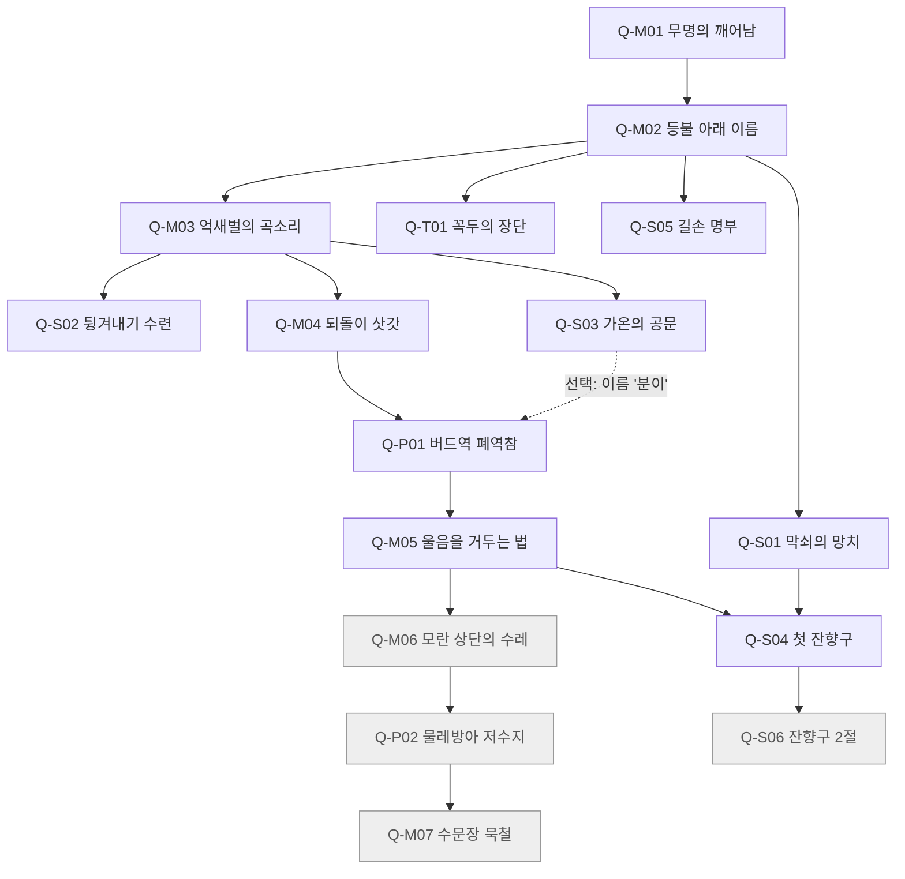

# 연무: 잔향의 문 — 퀘스트 설계 (quests)

> **문서 상태:** 기획 초안 v0.2 (2026-11-07) · 소유: design 담당 · 교차 검토 1차 반영(디자인 측 수정만) · **독립 검증 전** · 구현 전. 변경 근거·미해결 항목: [design-cross-review.md](../production/design-cross-review.md)
>
> 태그 규칙(**[요구] [지정] [제안] [가정] [측정]**)은 [concept.md 표기 규칙](concept.md#notation)을 따릅니다. 별도 표시가 없는 규칙·수치는 모두 **[제안]** 이며 측정 전 목표값입니다. 퀘스트 상태 저장·서버 권한·중복 지급 방지의 **구현 방식**은 technical 문서 소관이며, 이 문서는 **플레이어가 겪는 규칙**을 정의합니다.

관련 문서: [컨셉](concept.md) · [서사](narrative.md) · [전투와 아이템](combat-and-items.md) · [기술 아키텍처](../technical/architecture.md)

---

## 1. 표기와 레코드 형식

### 1.1 ID 규칙

| 접두 | 유형 | 예 |
|------|------|----|
| `Q-M` | 메인 (NPC가 끌고 가는 큰 이야기) | Q-M01 |
| `Q-S` | 사이드 (NPC 아크·제작·로어) | Q-S01 |
| `Q-T` | 수련 (콤보 분기·동작 해금) | Q-T01 |
| `Q-P` | 파티 던전 (1~4인 인스턴스) | Q-P01 |
| `O#` | 퀘스트 내 목표(objective) — **진행 저장 단위** | Q-P01/O3 |

### 1.2 레코드 필드

`ID · 이름 · 유형 · 범위(절편/1막 출시/후속) · 의뢰인 · 선행 · 공간과 인원 · 목표 · 보상과 해금 · 파티 규칙 · 재접속 규칙 · 서사 비트 · 목표 시간 · 텔레메트리`

### 1.3 퀘스트 상태

```text
LOCKED ──(선행 완료)──▶ AVAILABLE ──(수락)──▶ ACTIVE[O1..On] ──(마지막 목표)──▶ READY ──(보고)──▶ DONE
                                         │
                                         └─ 포기: ACTIVE → AVAILABLE (달성한 목표는 유지)
```

- **목표 단위 저장:** 각 `O#`이 완료되는 순간 서버에 저장된다. 카운트형 목표(예: 3/5)는 카운트도 저장된다.
- **포기해도 달성 목표는 남는다.** 다시 수락하면 이어서 진행.
- 메인 퀘스트는 실패 상태가 없다. 시간 제한 목표는 두지 않는다(첫 절편).
- technical 저장 이름과의 대응([architecture §12.3](../technical/architecture.md#123-퀘스트-진행)·[§14.1](../technical/architecture.md#141-ts-타입-스케치) `QuestProgress.state`): `AVAILABLE = available`, `ACTIVE = active`, `READY = completed`, `DONE = turned_in`. `LOCKED`는 저장하지 않고 선행 조건에서 계산한다. [제안]
- **퀘스트 보상은 캐릭터·퀘스트당 1회**(보고 시점에 원장으로 확정). 다시 수락·끊김·재요청으로 두 번 받지 않는다.

## 2. 공통 규칙: 공간 · 파티 · 재접속 · 이야기 <a id="party-rules"></a>

### 2.1 공간별 인원 (concept §6 요약)

| 공간 | 인원 | 이 공간에서 가능한 퀘스트 목표 |
|------|------|------------------------------|
| 마을 등잔포 | 채널당 20~40 목표 | 대화, 제작, 이름 새기기, 수련(개인 수련장), 파티 결성 |
| 필드 억새벌 (**첫 절편: 파티 인스턴스 1~4**) | 1~4 | 처치, 채집, 조사, 중간보스 |
| 던전 버드역 | 1~4 인스턴스 | 처치, 공유 상호작용, 보스 |
| 단독 공간 | 1 | 튜토리얼, 결정적 선택 |

> **technical 정렬 메모:** architecture.md의 `FieldRoom`(12~20)은 후속 공용 필드용입니다. 첫 절편의 억새벌은 `DungeonRoom`과 같은 **파티 전용 인스턴스(1~4)** 로 동작하면 됩니다.
>
> **결정 기록 준수:** 첫 절편의 어떤 필수 퀘스트도 **공용 전투 필드(12~20명)** 에 의존하지 않습니다. 공용 필드 버전은 [§5 후속 변형](#later-variants)에 따로 적었습니다.

### 2.2 파티 크레딧 규칙

| 목표 종류 | 크레딧 규칙 |
|-----------|-------------|
| **처치** | 같은 인스턴스 안에서 해당 목표가 ACTIVE인 **모든 파티원**에게 동시에 크레딧. 거리 제한 없음. |
| **수집·조사** | 채집 노드와 조사 대상은 **개인별**로 존재. 남이 줍는다고 내 것이 사라지지 않는다. |
| **공유 상호작용** (레버, 문, 등불 점화) | 한 명이 하면 같은 목표를 가진 전원 완료. 인스턴스 상태도 공유. |
| **개인 수행** (수련 목표, 이름 새기기) | 각자 직접 해야 완료. 동료는 대신할 수 없다. |
| **보스 처치** | 보스 사망 틱에 **좌석 보유자**(접속 중 또는 재접속 예약 중)이고, **이번 교전 시도**(보스 초기화 이후)에서 **기여 1회 이상**이면 크레딧. 기여 = 확정 피해 1회(소환물·상여 포함), 튕겨내기 1회, 일으키기 완료 1회, '분이' 응답 1회 중 하나. 상세·인원 산정은 [combat §6.3](combat-and-items.md#scaling). |
| **도우미** (그 퀘스트가 없거나 이미 완료) | 크레딧 조건은 위와 같다. 개인 드랍 + **동행 공적** 지급. 보스 '첫 처치' 보상(기억·공명석)은 **캐릭터별 보스당 1회**. |

- **드랍은 전부 개인 귀속**(굴림·분배 없음). 낯선 사람과의 다툼을 원천 차단. [제안]
- **첫 처치 보상과 퀘스트 보고 보상은 별개 지급 경로다.** 퀘스트 레코드의 "보상·해금" 칸에 `(첫 처치 확정)`으로 표시된 기억·공명석은 **보스 처치 틱에 첫 처치 보상으로만** 원장에 지급되며, 퀘스트 보고(READY → DONE) 때 다시 지급되지 않는다. 퀘스트 보고 보상은 그 칸의 나머지 항목(웨이포인트·다음 퀘스트 해금·레시피 공개 등)뿐이다. 그래서 첫 처치 기억·공명석은 캐릭터 × 보스당 정확히 1개다(Q-S04 재료 수지의 전제). [제안 — 독립 검증 F-03]
- **보스 보상은 처치 틱에 원장에 확정한다** — 접속 여부와 무관. 끊겨 있던 사람은 복귀(또는 다음 접속) 때 획득 알림만 받는다. 별도 우편 시스템은 두지 않는다. 인벤토리가 가득 차도 보상은 거부되지 않고 캐릭터 보관함에 쌓인다(architecture §13.3 `reward_overflow`). [제안] 보상 종류별 1회성 범위(멱등 키 범위)는 아래와 같으며, 키 설계는 technical 소관이다([X-T3](../production/design-cross-review.md#x-t3)).

| 보상 | 1회성 범위 |
|------|-----------|
| 보스 첫 처치 기억·공명석 | 캐릭터 × 보스, 영구 1회 |
| 보스 재처치 '기억 결' | 캐릭터 × 런(인스턴스) × 보스 |
| 일반·보스 개인 드랍 | 캐릭터 × 런 × 처치 대상 |
| 주간 변이 첫 클리어 공명석 | 캐릭터 × 자격 주차(§7 원칙 6) |
| 퀘스트 보고 보상 | 캐릭터 × 퀘스트, 영구 1회 |
| 동행 공적 | 캐릭터 × 런 × 보스 |
- 파티원 간 진행 단계가 달라도 입장 가능. 각자 자기 단계의 목표만 진행.
- 인원수 스케일링(적 체력·보스 기믹)은 [combat-and-items.md §6.3](combat-and-items.md#scaling).

### 2.3 재접속 규칙 <a id="reconnect"></a>

모든 초 단위 값은 `serverTick` 타이머다(히트스톱으로 늘어나지 않음, [combat §3.1](combat-and-items.md#clocks)).

| 상황 | 규칙 [제안 — 3초 보호는 지정] |
|------|------------------------------|
| 연결 끊김 감지 | 캐릭터는 **5초** 동안 제자리에 남는다(평소처럼 피격 가능 — 맞기 직전 연결을 끊어 피하는 악용 방지). 5초 뒤 **잔상**(반투명)으로 바뀐다: 피격·어그로·이름 부르기 대상 아님, 생존 인원으로 세지 않음. 5초 안에 쓰러지면 쓰러짐 규칙을 따른다. |
| 자리 예약 | 파티 슬롯과 인스턴스 좌석을 **180초** 예약. 예약 중 그 자리에 다른 사람을 초대할 수 없다. |
| 예약 내 복귀 — 일반 구간 | 같은 인스턴스, **마지막으로 지난 등불(체크포인트)** 에서 복귀. 달성 목표·카운트 유지. 체력은 끊길 때 값 그대로(복귀로 회복되지 않음). **재접속 보호 3초** 적용. |
| 예약 내 복귀 — 보스전 중 | **신규 입장은 차단, 그 교전의 참가자 명단에 있는 사람의 복귀는 허용.** 보스방 안쪽 입구에 **재접속 보호 3초** 상태로 합류해 전투를 잇는다. 보스 체력 배율은 교전 시작 인원으로 고정(끊김으로 변하지 않음, [combat §6.3](combat-and-items.md#scaling)). 교전 시작 전에 끊긴 사람은 문 앞(체크포인트 C)에서 교전 종료를 기다린다. |
| **재접속 보호 3초** [지정: 3초] | **보호 시작 전(좌석 재연결 ~ 시작 틱):** 캐릭터는 **잔상 상태를 유지**한다 — 비표적·어그로 없음·생존 인원 미산입, 그 사이 들어온 입력은 동작으로 적용하지 않는다. 로딩 중 맞지도 않고, 로딩을 늦춰 무적을 늘릴 수도 없게 하기 위해서다. **보호 시작 틱 = ① 첫 화면 상태 적용 응답 ② 첫 입력 수신 ③ 재연결 150틱(5초) 중 가장 이른 틱.** ②로 시작하면 그 첫 입력은 이동만 적용하고 공격·기술 같은 행동 입력은 버린다(첫 입력이 공격이라 보호가 시작 즉시 끝나는 일을 막음). 이어서 90 `serverTick`. 재연결부터 보호 종료까지 비표적 구간은 최대 240틱(8초)이며 그중 행동 가능한 시간은 보호 90틱뿐이다(architecture §12.2와 같은 규칙, 독립 검증 F-04). 무적·비표적·어그로 없음·잡기·이름 부르기 대상 제외. 이동·막기·회피는 보호를 유지한다. **공격·기술·잔향 해방·일으키기·상호작용** 입력 시 즉시 끝난다(보호 상태로 안전하게 동료를 일으키거나 때리는 악용 방지). 귀로등 '돌아오는 문'으로 전투 인스턴스에 돌아올 때도 같은 보호를 준다([§2.6](#portal)). |
| 예약 중 보스 처치 | 좌석 보유자(접속 중 + 예약 중) 가운데 이번 교전 시도의 기여 1회 이상이면 크레딧. 보상은 처치 틱에 원장으로 확정되고 복귀 시 알림([§2.2](#party-rules)). |
| 예약 만료 | 슬롯 해제(리더가 새 인원 초대 가능). 보스전 중이었다면 보스 배율 재계산([combat §6.3](combat-and-items.md#scaling)). 재접속하면 **마을**에서 시작. 퀘스트는 마지막 저장 목표까지 유지. 다음 입장 시 완료한 목표에 해당하는 인스턴스 상태(열린 문, 빠진 물 등)는 **완료된 상태로 다시 생성**. |
| 진행이 다른 파티의 인스턴스 생성 | 파티원 중 **한 명이라도 완료한 공유 상태는 완료로 생성**한다(architecture §11.1 X5 제안 수용). 그 공유 목표가 아직 ACTIVE인 파티원은 입장 시 공유 상호작용 크레딧을 받는다(§2.2 "공유 상호작용"과 같은 규칙). 처치·보스 목표는 미리 완료되지 않는다. |
| 파티원 전원 끊김 | 인스턴스를 180초 유지 후 종료. 보스전 중이었다면 보스는 초기화. |
| 1인 플레이 끊김 | 위와 동일. 혼자라도 180초 안에 돌아오면 이어서 한다. |
| 보상 중복 | 같은 보스 처치·같은 목표 보상은 [§2.2의 1회성 범위](#party-rules)를 넘어 지급되지 않는다(기술 요구사항, [concept §12](concept.md#cross-review)). |
| 리더 이탈 | 가장 오래 파티에 있던 접속 중인 사람에게 리더 위임. |

> **technical 정렬 메모:** 위 규칙은 [architecture.md §12](../technical/architecture.md#12-연결-끊김파티퀘스트-상태)의 좌석 유지(`allowReconnection`, 180초 후보)·"보스 페이즈 중 신규 입장만 차단, 기존 좌석 재접속 허용"·목표 단위 저장과 맞춘 것이다. 디자인 v0.2가 추가로 제안한 것(교차 검토 합의, **사용자 승인 아님**): ① 보스 크레딧의 **교전 시도별 기여 1회 조건**, ② **재접속 보호 3초**([지정] 값)와 그 시작·종료 조건([제안]), ③ 체력 배율 고정과 예약 만료 시 재계산, ④ '기존 좌석' = **그 교전의 참가자 명단**(던전 좌석 전체가 아님), ⑤ 보상은 처치 틱 원장 확정(우편 없음). technical 반영 여부는 [design-cross-review.md](../production/design-cross-review.md#cross-owner)에 추적한다.

**판정 테스트 시나리오:** [concept G7](concept.md#gates) — Q-P01의 O2(레버), O3(대합실), O4(보스전 1·3페이즈)에서 각각 끊김을 주입해 위 표대로 동작하는지 확인.

### 2.4 파티와 이야기 <a id="party-story"></a>

- 던전 안 이야기는 **20초 이하 비차단 말풍선**. 전투를 멈추는 컷신은 던전 입구·보스 처치 후에만.
- 보스 처치 후: 모두에게 **비차단 말풍선 20초**([combat §6.2](combat-and-items.md#boss-gokbi)) → 처치 20초 뒤 귀환 등불이 켜진다. 처음 보는 사람은 그와 별도로 **개인 컷신(최대 60초)** 을 보며, 그동안 그 캐릭터는 무적·비표적이고 머리 위에 `이야기 보는 중`이 표시된다. 귀환 등불은 각자 컷신이 끝난 뒤 쓸 수 있다. 본 사람은 건너뛰기. [제안 — v0.1의 20초/60초 두 값을 이렇게 정렬]
- **서사 선택은 개인.** [Q-M05](#q-m05)처럼 선택이 있는 장면은 마을/1인 공간에서만 진행.
- 상세 원칙: [narrative.md §9](narrative.md).

### 2.5 마을에서의 파티 형성

- **파티 등불:** 마을 광장의 게시대에 등불을 걸면 목적(예: `Q-P01 버드역, 2/4`)이 다른 길손에게 보인다. 클릭 한 번으로 신청.
- **빠른 합류:** 던전 입구에서 "낯선 길손과 함께" 선택 시, 같은 퀘스트 단계의 대기자와 자동 매칭(최대 60초 대기, 이후 1인 또는 현재 인원 입장 선택).
- 목표: [concept G5](concept.md#gates) — 모집 시작부터 입장까지 중앙값 2분 이내.
- **입장 일부 실패**(architecture §11.4 열린 질문에 대한 디자인 답) [제안]: 먼저 technical 기본안대로 **전원 취소 후 같은 논리 요청을 1회 자동 재시도**한다(재시도는 새 시도 키 `{transitionId}:{attempt}` — architecture §11.4 X11 해석 수용). 그래도 일부가 실패하면 성공 가능한 인원에게 "지금 입장 / 함께 다시 시도"를 묻고, 먼저 들어간 경우 실패한 파티원의 좌석은 180초 예약으로 남긴다. 보스 교전이 시작되면 신규 입장 차단 규칙(§2.3)이 그대로 적용된다.

### 2.6 귀로등(타운 포탈)과 돌아오는 문 <a id="portal"></a>

[요구] 타운포탈 → [제안] 아래 규칙. 서버 표현은 [architecture §11.6](../technical/architecture.md#116-귀로등타운-포탈과-돌아오는-문).

| 항목 | 규칙 [제안] |
|------|-------------|
| 사용 가능 위치 | 마을 밖 전투 공간 어디서나, **전투 중에도 사용 가능**. 보스 전투 공간(보스방) 안·튜토리얼 1인 공간·결정적 선택 장면에서는 불가. |
| 시전 | 3초(90 `serverTick`). 확정 피해를 받으면 취소. 히트스톱으로 늘어나지 않는다. 취소돼도 등불 기름을 쓰지 않는다. |
| 현장 쪽 문 | 시전 완료 자리에 **60초** 열린다. 같은 파티원은 이 문으로 따라 마을에 갈 수 있다(파티원이 있는 마을 채널로 배정). |
| 내 좌석 | 귀로등으로 나간 사람의 인스턴스 좌석은 **재접속 예약과 같은 180초 귀로 예약**으로 남는다. 예약 중 그 자리에 다른 사람을 초대할 수 없다. |
| 마을 쪽 문 | 귀로 예약이 살아 있는 동안 마을에 **나만 쓰는** 돌아오는 문이 남는다. 그 문으로 원래 인스턴스·원래 자리로 돌아가며, 도착 시 **재접속 보호 3초**(§2.3)를 받는다. 60초는 현장 쪽 문(파티원 따라오기)에만 적용된다. |
| 예약 만료·인스턴스 종료 후 | 마을 쪽 문이 사라진다. 다시 들어가면 그 구역 **마지막 등불 체크포인트**에서 새 인스턴스를 만든다(완료 목표 상태 반영, §2.3). |
| 보스전과의 관계 | 보스 교전이 진행 중이면 돌아와도 보스방 문 앞(체크포인트 C)에 도착하고 교전 종료를 기다린다(그 교전의 참가자가 아니므로). |
| 등불 기름 | 처음 10개 무료. 이후 상점·제작. **막힘 방지:** 보유량이 0이면 마을 또는 등불 웨이포인트에 도착할 때 1개를 채워 준다(도착 1회당 최대 1개). 소모·지급은 원장 연산이며 키 설계는 technical 소관. |
| 기름 청구와 전환 실패 | [제안 — 코디네이터 제안 수용, 독립 검증 F-02] ① 시전이 완료되면 그 **귀로등 전환 1건(논리 전환)** 에 기름 1개가 청구되며, 한 전환에는 **최대 1회**만 청구된다. ② 일시 실패(좌석 예약 실패, 접속 재시도, 토큰 재발급)는 **같은 전환을 다시 시도**하는 것이며 기름을 다시 청구하지 않는다. 플레이어는 시전을 다시 하지 않는다. ③ 재시도 한도(technical 제안: 시도 3회 또는 30초)를 넘거나, 이동이 성립하기 전에 플레이어·출발 공간이 취소해 **최종 실패**로 플레이어가 출발 공간에 남으면, 기름 1개를 **정확히 1회 반환**한다(원래 차감을 지우지 않고 반환 원장 항목을 따로 남김). 그 전환의 현장 쪽 문과 귀로 예약은 만들어지지 않은 것으로 처리한다. ④ 마을로 배치되면(대상 접속 실패 후 마지막 안전 마을 복귀 포함) 목적지 도달로 보고 반환하지 않는다. ⑤ 마을 쪽 문으로 돌아가는 전환에는 기름을 청구하지 않는다. 논리 전환 ID와 시도 키의 구분·반환 키는 technical 소관(F-01·F-02 기술 측). |
| 등불 웨이포인트 | 점화한 웨이포인트(등잔포·억새벌·버드역 앞) 사이 이동은 마을에서 기름 없이 가능. 귀로등은 '현장 → 마을'과 '마을 → 그 현장' 왕복용이다. |


## 3. 의존성 그래프 (첫 절편 + 1막 출시)



- 회색 노드는 **1막 출시** 범위, 나머지는 **첫 절편**.
- **필수 경로(절편):** M01 → M02 → M03 → M04 → P01 → M05 → S04 (S04는 S01도 필요). 나머지는 선택이지만 동작 해금(T01, S02)이 전투를 크게 쉽게 만든다.

## 4. 퀘스트 레코드

### Q-M01 무명의 깨어남 <a id="q-m01"></a>

| 필드 | 내용 |
|------|------|
| 유형·범위 | 메인 · **절편** |
| 의뢰인 | 꼭두 |
| 선행 | 없음 (첫 접속) |
| 공간·인원 | 안개 속 상여길 · **1인 전용** |
| 목표 | **O1** 꼭두를 따라 등불까지 이동 (WASD·마우스 조준) · **O2** 억새 잔향 3마리 처치 (약공 콤보) · **O3** 곡소리 파동을 회피로 1회 피하기 (빨간 텔레그래프 학습) · **O4** `약-약-강` 1회 성공 · **O5** 등잔포 나루 문 도착 |
| 보상·해금 | 환도(T0), 콤보 노드 `L1~L4`, `L-L-H`, 회피, 등잔포 진입, Q-M02 |
| 파티 규칙 | 파티 불가. 파티 중 접속해도 이 퀘스트는 1인 공간에서 진행. |
| 재접속 | 새 1인 공간을 만들고 마지막 완료 목표 다음부터. |
| 서사 비트 | 꼭두: "이름 없지? 나도." 안개 너머로 곡소리가 처음 들린다. |
| 목표 시간 | 6~8분 |
| 텔레메트리 | `tutorial_step_time`, `first_dodge_success`, `quit_during_tutorial` |

### Q-M02 등불 아래 이름 <a id="q-m02"></a>

| 필드 | 내용 |
|------|------|
| 유형·범위 | 메인 · **절편** |
| 의뢰인 | 한설 |
| 선행 | Q-M01 |
| 공간·인원 | 마을 등잔포 (다른 길손 20~40명이 보이는 공간) |
| 목표 | **O1** 꺼진 등불 3개 점화 (개인 수행 — 남의 화면에서는 이미 켜져 있을 수 있음) · **O2** 한설의 등불 아래 **이름 새기기** (캐릭터 이름 입력, 머리 위 표시 `무명` → 이름) · **O3** 귀로등 받기 · **O4** 억새벌 입구에서 귀로등을 써서 마을로 돌아오기 |
| 보상·해금 | **귀로등(타운 포탈)**, 등불 웨이포인트 1(등잔포), 이름 표시, Q-M03 / Q-S01 / Q-T01 / Q-S05 |
| 이름 규칙 | [제안] 이름은 **유일하지 않다**(선점 경쟁 방지 — 세계관상 같은 이름의 귀환자가 있을 수 있음). 동명이 같은 화면에 있으면 파티·명부 UI에 짧은 식별 태그를 함께 표시. 서버 금칙어 필터와 신고 대상(architecture §16). 절편에서는 한설에게 **1회 무료 재새김**, 신고 처리로 강제 재새김 가능. 출시 정책은 사용자 결정 — architecture X8에 대한 디자인 답 |
| 파티 규칙 | 개인 수행. 파티 상태여도 각자 진행. |
| 재접속 | 마을이므로 그대로 복귀. 목표 단위 저장. |
| 서사 비트 | 한설이 손목에 자기 이름을 다시 쓰는 장면이 배경에 잠깐 보인다(복선). |
| 목표 시간 | 5~7분 |
| 텔레메트리 | `name_carved`, `portal_first_use_time`, `town_strangers_visible_count` |

> **귀로등 규칙:** [§2.6](#portal)으로 옮겼다(v0.2). 요약: 마을 밖 어디서든(보스방 제외) 시전 3초, 현장 쪽 문 60초는 파티원 따라오기용, 내 좌석은 180초 귀로 예약, 마을 쪽 문은 예약이 살아 있는 동안 유효. 기름은 0개일 때 마을·웨이포인트 도착 시 1개 보충. [제안]

### Q-S01 막쇠의 망치 <a id="q-s01"></a>

| 필드 | 내용 |
|------|------|
| 유형·범위 | 사이드(제작) · **절편** |
| 의뢰인 | 강막쇠 |
| 선행 | Q-M02 |
| 공간·인원 | 마을(제작대) + 억새벌(채집) · 1~4 |
| 목표 | **O1** 억새벌에서 녹슨 철편 4개 채집 (개인 노드) · **O2** 제작대에서 환도 T1 또는 방어구 T1 제작 · **O3** 마을 수련장 허수아비에게 새 장비로 콤보 1회 |
| 보상·해금 | 제작대 T1, 막쇠 신뢰 1 |
| 파티 규칙 | 채집 노드 개인별. 파티원이 같이 필드에 있어도 각자 4개. |
| 재접속 | 채집 카운트 저장. |
| 서사 비트 | "산 사람 칼은 만들어 주지. 죽은 놈은 두드리는 게 아니다." |
| 목표 시간 | 6분 (필드 이동 포함, M03과 병행 가능) |
| 텔레메트리 | `first_craft_time`, `craft_choice` |

### Q-T01 꼭두의 장단 <a id="q-t01"></a>

| 필드 | 내용 |
|------|------|
| 유형·범위 | 수련(동작 해금) · **절편** |
| 의뢰인 | 꼭두 |
| 선행 | Q-M02 |
| 공간·인원 | 마을 개인 수련장 · 1인 |
| 목표 | **O1** 꼭두의 북 장단에 맞춰 `약공 … (쉼) … 약공` 박자 입력 3회 · **O2** 지연 베기 → 강공 연결 1회 · **O3** 방패 역졸 허수아비의 방패를 지연 베기로 넘기기 1회 |
| 보상·해금 | 콤보 노드 `L-(쉼)-L 지연 베기`, `지연 베기-H` ([콤보 트리](combat-and-items.md#combo-tree)) |
| 파티 규칙 | 개인 수행. |
| 재접속 | 수련장 재생성, 목표 단위 유지. |
| 서사 비트 | 꼭두: "상여 소리도 박자가 있어. 서두르면 넘어져." |
| 목표 시간 | 3~4분 |
| 텔레메트리 | `delayed_branch_attempts`, `delayed_branch_success_rate` |

> 이 수련은 선택이지만, 안내 없이 박자 분기를 발견하는지([G2](concept.md#gates))를 보기 위해 **테스트 빌드 A/B 그룹 중 한쪽은 퀘스트 표시를 숨긴다**. [제안]

### Q-M03 억새벌의 곡소리 <a id="q-m03"></a>

| 필드 | 내용 |
|------|------|
| 유형·범위 | 메인 · **절편** |
| 의뢰인 | 한설 |
| 선행 | Q-M02 |
| 공간·인원 | 억새벌 · **파티 인스턴스 1~4** |
| 목표 | **O1** 억새벌 두 번째 등불 점화 (공유 상호작용, 웨이포인트 2) · **O2** 곡소리꾼 2마리 처치 (가만히 서 있는 버릇을 벌하는 적) · **O3** 젖은 손 무리를 지나 피난민 짐 3개 조사 (개인) · **O4** 한설에게 보고 |
| 보상·해금 | 웨이포인트 2, Q-S02 / Q-S03 / Q-M04 |
| 파티 규칙 | 처치는 공유, 조사는 개인, 등불은 공유. |
| 재접속 | 등불 1·2가 체크포인트. 만료 시 마을 시작, 점화한 등불은 켜진 채 재생성. |
| 서사 비트 | 짐 속 편지: "분이 어멈이 울어 주었다. 우리 집엔 이제 울어 줄 사람이 없는데." |
| 목표 시간 | 10~12분 |
| 텔레메트리 | `death_cause_by_enemy`, `wailer_kill_time` |

### Q-S02 튕겨내기 수련 <a id="q-s02"></a>

| 필드 | 내용 |
|------|------|
| 유형·범위 | 수련(동작 해금) · **절편** |
| 의뢰인 | 강막쇠 (옛 군기시 장인 — 칼을 받는 법을 안다) |
| 선행 | Q-M03 |
| 공간·인원 | 억새벌 방패 역졸 무리 또는 마을 수련장 · 1~4 (목표는 개인 수행) |
| 목표 | **O1** 노란 텔레그래프 공격을 튕겨내기 5회 · **O2** 튕겨내기 → 약공 `빗겨치기` 1회 · **O3** 튕겨내기 → 강공 `되받아 베기` 1회 |
| 보상·해금 | 콤보 노드 `P-L 빗겨치기`, `P-H 되받아 베기`, 막쇠 신뢰 2 (T2 개조 해금) |
| 파티 규칙 | **개인 수행** — 동료가 대신 튕겨낼 수 없다. 단, 같은 적을 상대로 동시에 진행 가능. |
| 재접속 | 카운트 저장. |
| 서사 비트 | 막쇠: "칼은 받는 게 반이다. 내가 만든 도장은 받는 법이 없었지." (복선) |
| 목표 시간 | 5분 |
| 텔레메트리 | `parry_attempts`, `parry_success_rate`, `parry_branch_first_use` |

### Q-S03 가온의 공문 <a id="q-s03"></a>

| 필드 | 내용 |
|------|------|
| 유형·범위 | 사이드(조사·로어) · **절편** |
| 의뢰인 | 윤가온 |
| 선행 | Q-M03 |
| 공간·인원 | 억새벌 2곳 + 버드역 1곳 · 1~4 |
| 목표 | **O1** 억새벌 역졸 시신의 봉문사 문서 2부 회수 (개인) · **O2** 버드역 매표청 문서 1부 회수 (개인, Q-P01 진행 중 획득) · **O3** 가온에게 전달 |
| 보상·해금 | 곡비 어멈의 생전 이름 **'분이'** → 보스 3페이즈 `이름 부르기 응답` 선택지 해금 ([combat §6.2](combat-and-items.md#boss-gokbi)), **이름패 조각 1** (잔향구 재료), 로어 문서 3 |
| 파티 규칙 | 문서는 개인별. 파티원이 이 퀘스트가 없어도 Q-P01은 진행 가능. |
| 재접속 | 회수 문서 저장. |
| 서사 비트 | 가온: "삭명 기록에… 명부 사본과 인장 번호가 다릅니다. 이럴 리가 없는데." |
| 목표 시간 | 4분 (+ Q-P01 내 1분) |
| 텔레메트리 | `optional_lore_completion`, `boss_name_call_used` |

### Q-M04 되돌이 삿갓 <a id="q-m04"></a>

| 필드 | 내용 |
|------|------|
| 유형·범위 | 메인 · **절편** (중간보스) |
| 의뢰인 | 한설 → 꼭두 |
| 선행 | Q-M03 |
| 공간·인원 | 억새벌 안쪽 '갈림 나루' · **파티 인스턴스 1~4** (첫 절편은 공용 필드 아님) |
| 목표 | **O1** 같은 길을 도는 삿갓 발자국을 따라가기 (반복 경로 3바퀴째에 갈림길 발견) · **O2** 되돌이 삿갓 처치 |
| 보상·해금 | **되돌이의 기억**(첫 처치 확정), **공명석 1**(첫 처치 확정) — 둘 다 처치 틱 첫 처치 보상, 보고 시 재지급 없음([§2.2](#party-rules)) / 퀘스트 보고: 웨이포인트 3(버드역 앞), Q-P01 |
| 파티 규칙 | 보스 처치 크레딧 규칙(§2.2). 삿갓이 흉내 내는 콤보는 **파티원 각각의 최근 반복 콤보**를 따로 기록해 대상 플레이어에게 쓴다. |
| 재접속 | 보스전 중 끊김: 보스방 규칙 적용(§2.3). |
| 서사 비트 | 처치 후 삿갓 아래 얼굴 없는 등짐장수: "여기서… 또 돌면 되나?" 꼭두가 대신 대답한다: "이제 안 돌아도 돼." |
| 목표 시간 | 8~10분 |
| 텔레메트리 | `mimic_trigger_count`, `combo_path_entropy` (처치 전후 비교 — [combat C5](combat-and-items.md#combat-gates)와 같은 이름) |

### Q-P01 버드역 폐역참 <a id="q-p01"></a>

| 필드 | 내용 |
|------|------|
| 유형·범위 | 파티 던전 · **절편 핵심** |
| 의뢰인 | 한설 (가온 동행 대사) |
| 선행 | Q-M04 (Q-S03 선택) |
| 공간·인원 | 버드역 폐역참 · **1~4 인스턴스** · 인원별 스케일링 ([combat §6.3](combat-and-items.md#scaling)) |
| 목표 | **O1** 역참 진입 (입구 등불 = 체크포인트 A) · **O2** 물에 잠긴 마방에서 수문 레버 2개 당기기 — 공유 상호작용. 1인은 순차로, 다인은 동시에 당기면 **물이 빨리 빠지는 지름길** (체크포인트 B) · **O3** 대합실 정리 — 갑주귀 첫 등장 (튕겨내기 학습 확인) · **O4** 곡비 어멈 처치 (보스방, 체크포인트 C는 문 앞) |
| 보상·해금 | **곡비의 기억**(첫 처치 확정), **공명석 1**(첫 처치 확정) — 둘 다 처치 틱 첫 처치 보상, 보고 시 재지급 없음([§2.2](#party-rules)) / 레시피 `곡비의 손목끈` 공개 (**보스와 처음 마주친 순간 공개** — 져도 공개) / 퀘스트 보고: Q-M05 |
| 파티 규칙 | 처치·레버 공유. 보스 크레딧은 기여 기준. 도우미는 동행 공적 + 개인 드랍. 진행 단계가 다른 파티원도 함께 입장 가능. |
| 재접속 | §2.3 전체 적용. 체크포인트 A/B/C. O2 완료 후 만료되면 다음 입장 시 물이 빠진 상태로 생성. |
| 서사 비트 | 보스 전 가온의 말풍선: "여기서 피난민 백 명이… 기록엔 '없음'이라고만." 처치 후 곡비 어멈이 마지막으로 울음을 멈추고 상여 위에 앉는다. |
| 목표 시간 | 1인 25~30분 / 4인 15~20분 |
| 텔레메트리 | `party_size_at_entry`, `boss_attempts_to_clear`, `boss_phase_death_distribution`, `disconnect_events`, `boss_name_call_used` |

### Q-M05 울음을 거두는 법 <a id="q-m05"></a>

| 필드 | 내용 |
|------|------|
| 유형·범위 | 메인(선택) · **절편** |
| 의뢰인 | 한설, 강막쇠 |
| 선행 | Q-P01 |
| 공간·인원 | 마을 등잔포 — 선택 장면은 **1인 연출** |
| 목표 | **O1** 곡비의 기억을 한설에게 보여 주기 · **O2** 선택: **[풀어 준다]** 한설의 등불에 태워 보낸다 → `울음의 재` 획득, 마을 등불 1개 영구 점화, 한설 대사 분기 / **[남긴다]** 막쇠에게 가져가 두드린다 → `곡비의 기억` 유지, 막쇠 대사 분기 · **O3** 막쇠와 대화 |
| 보상·해금 | 어느 쪽이든 **잔향구 제작 재료로 동일하게 쓰인다** (`울음의 재` = `곡비의 기억` 대체재). 장인 등급 T3(잔향구) 해금, Q-S04 |
| 파티 규칙 | 개인 선택. 파티 상태여도 선택 장면은 각자. |
| 재접속 | 선택 확정 전 끊기면 선택 장면 처음부터. 확정 후엔 결과 저장. |
| 서사 비트 | 어느 쪽이든 막쇠는 처음으로 잔향을 두드린다: "보내든 남기든, 누군가는 기억해야겠지." 선택은 3막 새 명부 장면에서 다시 읽힌다([narrative §8](narrative.md)). |
| 목표 시간 | 4~5분 |
| 텔레메트리 | `choice_release_or_keep`, `choice_time_taken` |

### Q-S04 첫 잔향구 <a id="q-s04"></a>

| 필드 | 내용 |
|------|------|
| 유형·범위 | 사이드(제작) · **절편 핵심** |
| 의뢰인 | 강막쇠 |
| 선행 | Q-M05, Q-S01 |
| 공간·인원 | 마을 제작대 + 수련장 · 1인 |
| 목표 | **O1** 잔향구 하나 선택해 제작: `곡비의 손목끈`(곡비의 기억/울음의 재 + 공명석 1 + 무명천 3) 또는 `되돌이 삿갓`(되돌이의 기억 + 공명석 1 + 억새 줄기 3) · **O2** 장착 · **O3** 바뀐 동작을 수련장 또는 필드에서 5회 사용 |
| 보상·해금 | 잔향구 장착 슬롯 1, 명부 게시판에 "첫 잔향구" 문장 추가 (T2 각인은 Q-S02, T3 제작은 Q-M05에서 이미 해금) |
| 파티 규칙 | 개인. |
| 재접속 | 제작은 서버 확정 1회 (중복 제작·재료 이중 차감 없음 — technical 요구). |
| 서사 비트 | 막쇠가 망치를 내려놓으며 손이 떨린다. 장착 순간 짧은 기억 플래시(생전 곡비/등짐장수의 몸놀림). |
| 목표 시간 | 3~5분 |
| 텔레메트리 | `legendary_choice`, `legendary_action_use` (장착 후 15분 집계, [G3](concept.md#gates)·[combat C10](combat-and-items.md#combat-gates)) |

> **재료 설계 원칙:** 첫 잔향구의 필수 재료는 **모두 첫 처치 확정 보상 + 일반 진행 중 자연 획득량**으로 충족된다. 절편에서 같은 던전을 반복할 필요가 **0회**여야 한다.
> **재료 수지(필수 경로 1회 완주 기준):** 첫 처치 확정으로 `되돌이의 기억` 1(Q-M04) + `곡비의 기억`/`울음의 재` 1(Q-P01) + 공명석 2(Q-M04 1, Q-P01 1). 따라서 **두 잔향구를 모두 반복 없이 제작할 수 있다**(절편 장착은 1개). v0.1의 "두 번째 잔향구는 재도전 1회로 공명석 확정"은 [combat §8.3](combat-and-items.md#crafting)(재도전 공명석은 주간 변이 첫 클리어만)과 모순되어 삭제했다. 해체 시 기억·공명석 전액 반환(combat §8.5)이므로 바꿔 끼우는 데에도 반복이 필요 없다.

### Q-S05 길손 명부 <a id="q-s05"></a>

| 필드 | 내용 |
|------|------|
| 유형·범위 | 사이드(사회) · **절편**, 필수 아님 |
| 의뢰인 | 한설 (마을 명부 게시판) |
| 선행 | Q-M02 |
| 공간·인원 | 마을 + 아무 전투 공간 |
| 목표 | **O1** 다른 길손과 파티를 맺고 **전투 목표 하나**를 함께 완료 (파티 등불·빠른 합류 모두 인정) · **O2** 함께한 길손에게 감정표현 `절` 보내기 · **O3** 명부 게시판에서 서로의 이름 확인 / **대체 경로:** 3분 이상 모집해도 합류가 없으면 O1을 "다른 길손의 파티 등불에 응답하거나, Q-P01을 1인으로 클리어"로 대체 |
| 보상·해금 | 감정표현 3종, **동행 공적**(도우미 보상 화폐) 해금, 명부 게시판에 내 이름 노출 |
| 파티 규칙 | O1은 2인 이상 파티에서만 정상 경로. 대체 경로는 사람 부족 시 막힘 방지용. |
| 재접속 | 목표 단위 저장. |
| 서사 비트 | 한설: "여기 새겨진 이름들은 서로를 기억해 준 사람들이야." |
| 목표 시간 | 자유 |
| 텔레메트리 | `first_party_formed_time`, `fallback_path_used`, `emote_sent` |

## 5. 1막 출시 퀘스트 (절편 이후) <a id="later-variants"></a>

### Q-M06 모란 상단의 수레

| 필드 | 내용 |
|------|------|
| 범위 | 1막 출시 |
| 선행 | Q-M05 |
| 공간·인원 | 억새벌 동쪽 둑길 · 1~4 인스턴스 |
| 목표 | **O1** 모란과 대화 · **O2** 수레 호위(안개 농도가 오르면 수레 등불을 켜는 공유 상호작용) · **O3** 수문에서 쫓겨난 무명 피난민과 대화 |
| 해금 | 모란 상점(귀로등 기름·소모품), Q-P02 |
| 파티·재접속 | 호위 중 끊김: 수레는 마지막 등불 위치에 정지 대기(예약 시간 동안). |
| 서사 비트 | 모란이 무명 피난민에게 이름패를 몰래 건네는 장면(2막 배신 복선). |

### Q-P02 물레방아 저수지

| 필드 | 내용 |
|------|------|
| 범위 | 1막 출시 |
| 선행 | Q-M06 |
| 공간·인원 | 물레방아 저수지 · 1~4 인스턴스 |
| 목표 | **O1** 멈추지 않는 방아 3개 정지 (공유) · **O2** 물레 노파 처치 · **O3** 방앗간에서 '명부 사본' 회수 (개인) |
| 해금 | 무기 2종(월도·편곤 후보) 제작법, Q-M07 |

### Q-M07 수문장 묵철 (1막 보스)

| 필드 | 내용 |
|------|------|
| 범위 | 1막 출시 |
| 선행 | Q-P02 |
| 공간·인원 | 버드강 수문 · 1~4 인스턴스 |
| 목표 | **O1** 수문 앞 피난민 행렬 지키기 · **O2** 묵철 처치 · **O3** 한설과 함께 묵철의 이름을 등불에 올리기 (마을, 1인 연출) |
| 해금 | 잔향구 `묵철 수문창` 레시피, 묵철이 등잔포 수호 잔향이 됨(마을 외형 변화), 2막 진입 |

### Q-S06 잔향구 2절 <a id="q-s06"></a>

| 필드 | 내용 |
|------|------|
| 범위 | 1막 출시 (T4 승화) |
| 선행 | Q-S04 + 해당 잔향구의 보스 재처치 |
| 목표 | 잔향구별 **도전 과제**(예: `곡비의 손목끈` — 곡비 어멈의 울음을 한 전투에서 5회 튕겨내기) 1회 달성 → 막쇠에게 승화 |
| 해금 | 잔향구의 두 번째 동작 변화(2절). 수치 상승 없음. 상세 [combat §8](combat-and-items.md#crafting) |

### 공용 필드 변형 (후속, 첫 절편 아님)

결정 기록의 **후속 공용 필드 12~20명**이 도입되면, Q-M04 되돌이 삿갓은 `Q-E01 갈림 나루의 되돌이` **공개 이벤트**로 별도 운영할 수 있습니다. 메인 Q-M04는 그대로 파티 인스턴스로 남겨 **필수 진행이 공용 필드에 의존하지 않도록** 합니다.

| 항목 | 공개 이벤트 규칙 [제안] |
|------|------------------------|
| 참여 | 지역에 있는 누구나. 파티 불필요. |
| 크레딧 | 보스 체력의 3% 이상 피해, 또는 튕겨내기 1회, 또는 쓰러진 길손 일으키기 1회 |
| 스케일링 | 참여 인원 구간(1~5 / 6~12 / 13~20)별 체력·흉내 대상 수 |
| 보상 | 개인 드랍. 첫 처치 기억은 Q-M04와 공유하지 않음(중복 방지) |
| 끊김 | 공개 이벤트는 예약 없음. 기여 기록은 이벤트 종료 시점까지 유지 |

## 6. 2·3막 메인 줄기 (ID 예약, 개요)

| ID | 이름 | 막 | 핵심 | 보스/중간보스 |
|----|------|----|------|---------------|
| Q-M08 | 탈골의 손님 | 2 | 새 허브, 모란의 이름패 거래 목격 | — |
| Q-P03 | 열두 탈판 | 2 | 탈을 바꿀 때마다 패턴 변화 / **모란의 배신** | 열두 탈판 |
| Q-M09 | 흑관의 문서 | 2 | 가온이 아버지 윤헌의 판결문을 본다 | — |
| Q-P04 | 산군재 | 2 | 무너진 서낭당, 범의 사냥 | 산군 |
| Q-S07 | 도깨비 장 (숨은) | 2 | 내기 규칙 장판 | 도깨비 장 |
| Q-M10 | 꺼지는 등불 | 2 | 한설의 등불 속 한결의 기억으로 진입 (1인) | — |
| Q-M11 | 판결 | 2 | 귀환자 재삭명 저지. **플레이어 = 귀환자 확인** | 판관 윤헌 |
| Q-M12 | 성문 밖 | 3 | 운경 피난촌 허브, 모란 상단 보급선 | — |
| Q-P05 | 봉문사 서고 | 3 | 가온의 증언 자료 확보 | 서고 수호 잔향 |
| Q-M13 | 붓칼 | 3 | 막쇠가 삭명 인장을 녹임 | — |
| Q-P06 | 문을 연 손 | 3 | 꼭두의 선택 | 서휘 |
| Q-M14 | 새 명부 | 3 | 플레이어의 선택들이 읽힘, 최종전 | 명부귀 |

## 7. 반복 콘텐츠 원칙 (퀘스트 측면)

1. **카운트 목표 상한 5.** "30마리 처치" 류 목표는 만들지 않는다. 각 목표는 **새 적이나 새 동작을 시험**해야 한다.
2. **첫 처치 확정 보상.** 보스의 '기억'과 공명석은 첫 처치에 반드시 지급. 확률 드랍으로 메인 진행을 막지 않는다.
3. **필수 반복 0회 (절편).** 첫 잔향구까지 같은 전투 공간을 반복할 필요가 없다 ([Q-S04 주석](#q-s04)).
4. **반복은 변주로.** 재도전 시 보스방에 **문 변이**(예: "되돌이의 저주 — 같은 콤보 3회 연속 시 약화")가 무작위로 붙어 다른 동작을 요구. 상세 [combat §9](combat-and-items.md#anti-grind).
5. **도우미도 성장한다.** 동행 공적으로 공명석·재료를 교환 → 낯선 사람을 돕는 것이 손해가 아니게.
6. **일일 숙제 없음.** 출석형 의무 퀘스트를 두지 않는다. 주간 변이 보상은 누적형 — **이월은 최대 1주분**: 지난주가 **자격 주**였는데 놓쳤으면 이번 주 첫 변이 클리어에서 이번 주 몫 + 밀린 1주 몫을 함께 받는다(한 번에 최대 2개). 2주 이상 밀린 몫은 쌓이지 않는다(복귀 부담 없이, 몰아 받기 비축도 없게). [제안 — architecture X12 답]
   - **자격 주** [제안 — 코디네이터 제안 수용, 독립 검증 F-15]: 그 주가 **시작하기 전에** ① 캐릭터가 이미 생성돼 있었고 ② 그 캐릭터의 **주간 변이가 해금**(처음으로 보스 첫 처치를 마침)돼 있던 주. 캐릭터 생성 주·변이 해금 주와 그 이전 주는 자격 주가 아니므로 **이월 대상이 될 수 없다.** 따라서 새 캐릭터나 막 해금한 캐릭터의 첫 변이 클리어는 1개만 받는다. 자격 판정과 키 표현은 technical 소관(architecture §13.2 `weekly` 행).

## 8. 퀘스트 QA 체크리스트

- [ ] 필수 경로(M01→M02→M03→M04→P01→M05→S04)를 1인으로 완주 가능
- [ ] Q-P01을 1·2·4인으로 각 1회 클리어
- [ ] 진행 단계가 다른 2인 파티(한 명은 Q-P01 완료자)로 입장 시 크레딧·보상이 규칙대로
- [ ] §2.3 재접속 표의 모든 행을 Q-P01에서 재현
- [ ] Q-M05 두 선택 모두 Q-S04 제작 가능
- [ ] 첫 잔향구까지 같은 전투 공간 반복 0회
- [ ] 같은 보상이 두 번 지급되지 않음 (끊김·재요청 포함)
- [ ] Q-S05 대체 경로가 사람이 없는 서버에서도 동작
- [ ] 보스전 중 끊김 → 180초 안 복귀 시 보스방 안쪽 입구 + 보호 3초(90틱), 공격 입력 시 보호 즉시 종료
- [ ] 보스전 중 예약 만료 → 보스 남은 체력 비율 유지·배율 재계산, 만료된 사람은 크레딧 없음
- [ ] 기여 0회인 좌석 보유자는 보스 크레딧을 받지 않음 / 기여 1회(일으키기만)인 도우미는 받음
- [ ] 귀로등: 전투 중 시전 → 피격 시 취소·기름 미소모, 파티원 60초 안 따라오기, 마을 쪽 문으로 원래 자리 복귀(보호 3초), 예약 만료 후 마지막 등불에서 재생성
- [ ] 등불 기름 0개 → 마을 도착 시 1개 보충, 반복 도착으로 2개 이상 쌓이지 않음
- [ ] 귀로등 전환 일시 실패 → 같은 전환 재시도, 기름 추가 차감 없음 / 최종 실패로 출발 공간에 남음 → 기름 정확히 1개 반환, 현장 쪽 문·귀로 예약 없음
- [ ] Q-M04·Q-P01 보고 시 기억·공명석이 다시 지급되지 않음(첫 처치 보상 1개씩만)
- [ ] 새 캐릭터·변이 해금 직후 캐릭터의 첫 주간 변이 클리어는 공명석 1개(이월 없음) / 자격 주를 1주 놓친 캐릭터는 2개
- [ ] 재접속 후 보호 시작 전(로딩 중) 캐릭터가 잔상으로 비표적, 입력 미적용, 첫 입력 또는 화면 적용 응답에서 보호 90틱 시작
